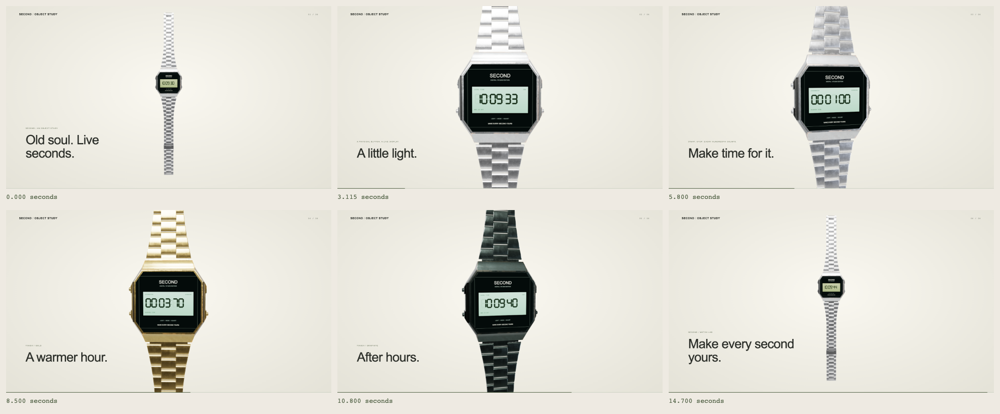
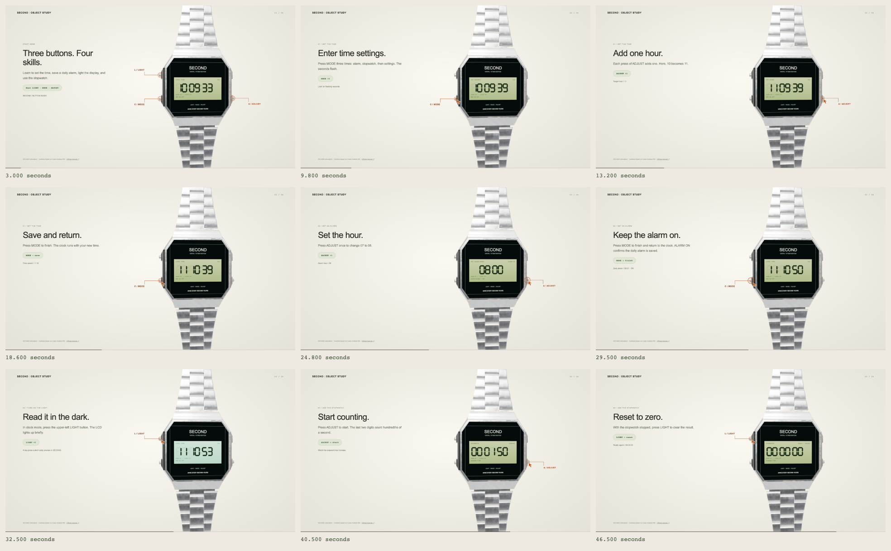

# SECOND / Showcase

A standalone Three.js digital watch with an interactive Watch Lab, a repeatable 15-second product showcase, and a 56-second button tutorial. The first film compares finishes. The second teaches time setting, a daily alarm, the light, and stopwatch start/stop/reset with animated pointers attached to the actual 3D buttons.



Extracted from [sses79/3d-action](https://github.com/sses79/3d-action) at commit [`e8e9cea`](https://github.com/sses79/3d-action/commit/e8e9cea06b6ac8994bcbcc10dd663ab8a691910f). The original watch files were verified against that commit before copying. Citrus Jelly and Animation Studio are separate projects and are not included here.

## Run

Requires Node.js 22.13 or later and npm.

```sh
npm ci
npm run dev
```

Open <http://127.0.0.1:5173>. Choose **Showcase** or **How to use it**:

- Product film: <http://127.0.0.1:5173/?showcase=1>
- Button tutorial: <http://127.0.0.1:5173/?tutorial=1>

Pause and scrub either sequence; **Back to Watch Lab** restores the live watch and your preferences. Reduced-motion preferences start both films paused.

The watch uses Three.js 0.186.1 `WebGPURenderer` with WebGL2 fallback. Add `?webgl=1` to exercise the fallback. All browser dependencies and the GLB are local; no CDN or API key is needed.

## Watch Lab

Drag to orbit and scroll or pinch to zoom. Use the physical buttons or panel controls:

- **Clock:** LIGHT briefly illuminates the face; MODE opens the alarm; ADJUST switches 12/24h.
- **Mode cycle:** clock → alarm → stopwatch → time settings → clock.
- **Time settings:** LIGHT selects a field; ADJUST changes it; MODE saves.
- **Alarm:** LIGHT selects hour/minute; ADJUST adds one; MODE finishes. Outside editing, ADJUST cycles alarm-only, signal-only, both, and off.
- **Stopwatch:** ADJUST starts/stops; LIGHT resets when stopped or splits while running.
- **Done**, **Sync to device**, and **Reset stopwatch** perform their named actions.

Branding, inscription, finish, time offset, 12/24-hour preference, and alarm settings are stored in this browser. The films use their own fixed clock and event replay; they do not save scripted changes into your preferences. Keyboard shortcuts: L / M / A; Enter saves settings; Escape leaves a film when focus is outside an input.

The daily alarm runs while the page is open and active. Enable **Sound on** for its audible cue; LIGHT dismisses a ringing alarm. This browser alarm is not an operating-system notification or background reminder.

## Manual and second film



The tutorial is based on Casio's official [Operation Guide 10B+7L (module 593)](https://www.casio.com/content/dam/casio/global/support/manuals/watches/pdf/5/593/qw593_EN.pdf). Its L / C / A buttons map to SECOND's upper-left LIGHT, lower-left MODE, and right-side ADJUST. All text and animated callouts here are original; the manufacturer's PDF is linked rather than included in this repository.

| Time | Lesson |
| --- | --- |
| 00:00 | Locate the three physical buttons |
| 00:07 | Set hours and minutes, then save |
| 00:20 | Set and enable a daily alarm at 08:01 |
| 00:31 | Illuminate the face |
| 00:35 | Start, stop, and reset the stopwatch |
| 00:50.5 | Recap and practice |

This is a SECOND simulation, not a certified Casio emulator. It adapts the lamp to a 1.2-second tap preview, does not implement hold-to-repeat or settings inactivity timeout, and uses the browser's Gregorian calendar. The first product film retains its original simplified watch state; live controls and the instructional film share `ManualWatchState`. The exported films are silent, with instructions and animated cues on screen.

## Capture

Install Google Chrome, or set `CHROME_PATH` to a Chromium executable. Video export additionally requires ffmpeg with libx264.

```sh
# Six moments in one contact sheet, plus a state manifest
npm run capture -- sheet

# Exact-time full-size PNGs
npm run capture -- stills --times 0,3.115,5.8,8.5,10.8,14.7

# Silent 15-second 1080p30 MP4
npm run capture -- video --fps 30 --out out/second.mp4

# Second film: button tutorial, plus a nine-frame review sheet
npm run capture -- video --film tutorial --out out/second-tutorial.mp4
npm run capture -- sheet --film tutorial

# Phone composition or forced WebGL2 capture
npm run capture -- sheet --width 390 --height 844 --out out/mobile.png
npm run capture -- sheet --webgl --out out/webgl.png
```

Captures use the same scene, fixed UTC showcase clock, and absolute-time camera/button evaluation as the preview. Seek order does not change the result. `?capture=1&t=8.5` opens a paused composition with playback controls hidden. Captures are repeatable within the tested browser/backend; fonts and GPU output can vary between platforms. The exporter captures browser frames at fixed times, without temporal supersampling or motion blur. Output goes into ignored `out/`.

## Build and verify

```sh
npm run build
npm test
npm run test:browser
```

`dist/` is a standalone static site. The included localhost server serves only the public build files. `npm run dev` rebuilds on source changes and restarts the server; refresh the browser afterward. `PORT=5174 npm run preview` starts a fresh build on another port.

The unit checks cover both watch states, manual button sequences, alarm persistence and triggering, source/final model structure, deterministic event replay, camera endpoints, and the server's public routes. Browser checks use actual projected 3D button positions to set an alarm, check the tutorial's clock and stopwatch outcomes, compare images after seeking backwards, and validate callout anchors. Both WebGPU and forced WebGL2, reduced motion, and a 390px phone viewport are checked. Screenshots go to `out/verification/`. A phone viewport check is not a physical-device test.

## Files

| File | Purpose |
| --- | --- |
| `watch/main.js` | Three.js scene, live canvas face, picking, and showcase integration |
| `watch/state.js` | Original state and shared monotonic stopwatch |
| `watch/manual-state.js` | Manual-style live controls, daily alarm, lamp, and split/reset |
| `watch/showcase.js` | Fixed clock, button events, camera keyframes, finishes, captions |
| `watch/tutorial.js` | Second film: timed instructions and real button event replay |
| `watch/callouts.js` | SVG rings, leader lines, labels, and animated press pointers |
| `watch/assets/watch.glb` | Self-contained 2.17 MB runtime model |
| `watch/source/second-watch.blend` | Editable prepared Blender scene with packed textures |
| `scripts/capture.mjs` | Stills, contact sheets, video, and capture manifests |
| `docs/watch/` | Original asset preparation and implementation notes |

Asset rebuild, when Blender is installed:

```sh
python3 watch/prepare_asset.py
blender --background --factory-startup --python watch/prepare_blender.py
npm run build
```

## Credits

The original [Digital Wrist Watch](https://polyhaven.com/a/digital_wrist_watch) is by Adrian C / Poly Haven and is [CC0](https://polyhaven.com/license). The model was prepared in Blender for SECOND in `sses79/3d-action`. Three.js is MIT licensed; its license is retained in `watch/source/THREE-LICENSE.txt`.

The showcase's explicit-time rendering and contact-sheet workflow were inspired by [mexicat/pdoom-video](https://github.com/mexicat/pdoom-video). No code, music, fonts, or imagery from that repository was copied.
